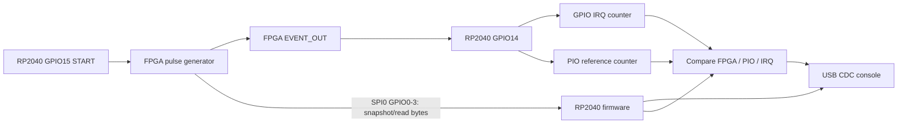

# Architecture

## Data path

## Runtime sequence

1. Firmware starts the watchdog and USB serial console.
2. Firmware initializes GPIO15 as the FPGA burst START output.
3. Firmware powers/configures the FPGA by transmitting the embedded MCU-compatible bitstream over SPI0.
4. SPI0 is re-used at 100 kHz for the FPGA's counter readback protocol.
5. GPIO14 rising edges are counted by the direct `IO_IRQ_BANK0` handler.
6. The PIO state machine independently counts pulses on GPIO14 and pushes the result after the configured quiet period.
7. When the IRQ count stops changing for 50 ms, firmware reads the FPGA snapshot and PIO result and prints the comparison.

## Burst generation

The Verilog synchronizes START. A rising edge on the synchronized START signal clears the pulse counter and starts the event generator. The event output toggles after the half-period counter reaches `HALF_PERIOD_LIMIT`. `pulses_sent` increments on each rising edge and the generator stops after 10,000 pulses.

For the current source:

- `HALF_PERIOD_LIMIT = 314`
- Assumed FPGA clock = 50 MHz
- Approximate pulse frequency = 79.37 kHz
- Number of generated rising edges = 10,000

## Independent checks

- **Generator check:** SPI readback from the FPGA reports 10,000.
- **PIO vs FPGA check:** PIO observed count equals FPGA internal count.
- **IRQ vs PIO check:** GPIO IRQ observed count equals PIO observed count.
- **Overall result:** passes only when the burst finishes without timeout and all three counts agree.
